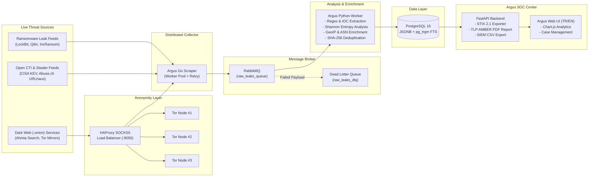

# ARGUS — Enterprise Distributed CTI & Data Leak Intelligence Platform


-4169E1?logo=postgresql&logoColor=white)


**Argus** is an end-to-end distributed **Cyber Threat Intelligence (CTI)** and **Data Leak Monitoring** platform designed for modern Security Operations Centers (SOC). It anonymously crawls Dark Web (`.onion`) services, ransomware leak portals, and open threat feeds via a load-balanced Tor cluster, enriches extracted IOCs with Shannon Entropy and GeoIP/ASN telemetry, and exports actionable intelligence in **OASIS STIX 2.1** format.

> **Bilingual Interface (TR / EN):** Argus features a built-in real-time language switcher (`TR` / `EN`) in the SOC Web Dashboard and generates both Turkish and English executive incident reports.


---

## System Architecture / Sistem Mimarisi



---

## Key Capabilities (English)

1. **Multi-Node Tor Proxy + HAProxy Load Balancing (`infra/tor` & `infra/haproxy`):**
   * Routes SOCKS5 traffic across 3 isolated Tor containers using Round-Robin load balancing on port `9050` with automated health checks.
2. **Concurrent Go Scraper (`collector-go`):**
   * Uses Goroutine worker pools to concurrently crawl `.onion` hidden services and CTI feeds with 3-stage exponential backoff retry logic.
3. **Asynchronous Queue & Fault Isolation (`RabbitMQ + DLQ`):**
   * Decouples ingestion from analysis via `raw_leaks_queue` and isolates malformed payloads into `raw_leaks_dlq` (Dead Letter Queue).
4. **IOC Extraction, Shannon Entropy & GeoIP/ASN Enrichment (`analyzer-python`):**
   * Extracts `email:password` pairs, AWS/GitHub/Stripe/Slack tokens, `CVE-YYYY-XXXXX` vulnerabilities, IPv4 addresses, domains, and IBANs.
   * Calculates **Shannon Entropy** ($H \ge 4.25$ bits/char) to detect unstructured cryptographic secrets and private keys.
   * Performs automated **GeoIP & ASN enrichment** on public IPv4 indicators and **SHA-256 content deduplication** across sources.
5. **Enterprise Standards: OASIS STIX 2.1, TLP:AMBER Reports & Case Management (`dashboard-web`):**
   * Exports structured `OASIS STIX 2.1` JSON bundles, printable `TLP:AMBER` executive incident reports, and full SIEM CSV dumps.

---

## Öne Çıkan Mühendislik Yetenekleri (Türkçe)

1. **Çoklu Tor Proxy + HAProxy Load Balancing (`infra/tor` & `infra/haproxy`):**
   * Hız sınırlarına (rate-limit) takılmamak için 3 izole Tor container'ı önünde `HAProxy` SOCKS5 yük dengeleyici çalışır.
2. **Go Eşzamanlı Veri Toplayıcı (`collector-go`):**
   * Goroutine Worker Pool mimarisi ile aynı anda birden fazla `.onion` ve Clearnet CTI kaynağını tarar, 3 aşamalı `retry` mekanizması uygular.
3. **Derin IOC Çıkarımı, Shannon Entropi ve GeoIP/ASN Zenginleştirme (`analyzer-python`):**
   * Kimlik bilgilerini, API anahtarlarını, CVE kodlarını ve yüksek entropili gizli anahtarları tespit eder; IP adreslerini ülke/ASN bilgisiyle zenginleştirir ve **SHA-256 Deduplication** ile veri tekrarını önler.
4. **Kurumsal Standartlar & Çift Dilli Arayüz (`dashboard-web`):**
   * **TR / EN Dil Seçeneği**, sağdan kayarak açılan **Threat Inspector** detay çekmecesi, **OASIS STIX 2.1** JSON çıktısı, **TLP:AMBER** PDF Olay Raporu ve **SOC Case Management** içerir.

---

## Quick Start / Kurulum ve Çalıştırma

### 1. Prepare Environment Variables / Ortam Değişkenleri
```bash
cp .env.example .env
```

### 2. Build and Start Containers / Servisleri Başlatın
```bash
docker compose up -d --build
```

### 3. Access Endpoints / Erişim Adresleri

| Service | URL | Description |
| :--- | :--- | :--- |
| **Argus SOC Dashboard (TR/EN)** | [http://localhost:8000](http://localhost:8000) | Live Threat Radar, Analytics, Case Management & Target Control |
| **OpenAPI / Swagger Docs** | [http://localhost:8000/docs](http://localhost:8000/docs) | Interactive REST API Documentation |
| **HAProxy Tor Statistics** | [http://localhost:8404/stats](http://localhost:8404/stats) | Real-time health and traffic metrics of the 3x Tor SOCKS5 nodes |
| **RabbitMQ Management** | [http://localhost:15672](http://localhost:15672) | Queue & DLQ monitor (`cti_broker` / `cti_broker_pass`) |

---

## Unit Tests / Birim Testleri

```bash
# Python CTI Analyzer & Entropy Engine Tests
docker exec cti-analyzer-python python -m unittest discover -v

# Go Concurrent Scraper HTML & .onion Extraction Tests
cd collector-go && go test -v ./...
```

---

## License / Lisans

Licensed under the [MIT License](LICENSE).
